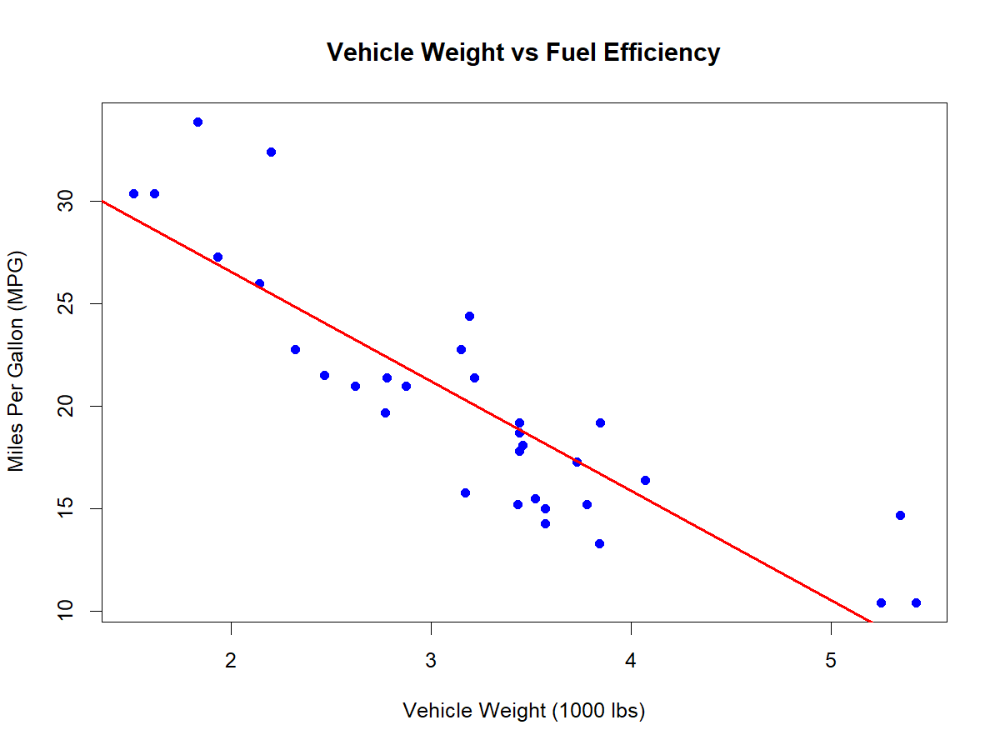
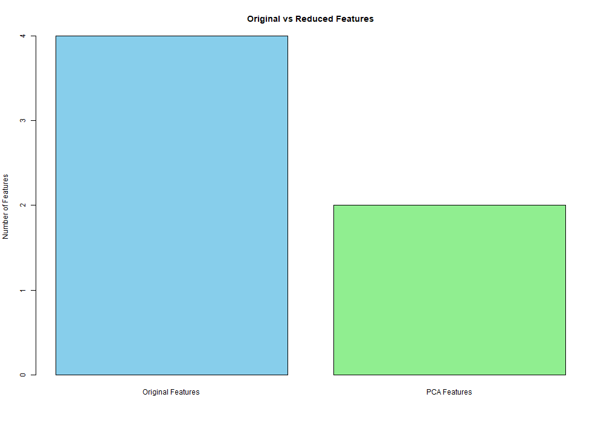

# 📊 R Data Analytics Portfolio

### Exploring Data | Building Models | Evaluating Results

A collection of data analytics and statistical modelling projects developed using **R Programming**. This portfolio demonstrates practical applications of regression analysis, classification algorithms, model evaluation and dimensionality reduction using two different real-world datasets.

<p align="center">
  
  
  
  
</p>

<p align="center">
  
  
  
  
</p>

---

## 📌 Project Overview

This repository contains two independent data analytics assignments developed as part of practical work in R Programming.

Both assignments explore different approaches to analysing datasets, identifying patterns, building predictive models and interpreting results.

| Project | Dataset | Main Techniques |
|---|---|---|
| Automobile Performance Prediction | mtcars | Linear Regression, Polynomial Regression, Cross-Validation |
| Iris Flower Classification | Iris | KNN, PCA, Factor Analysis |

### 🎯 Project Objectives

- Explore and understand structured datasets.
- Apply statistical and machine learning techniques using R.
- Build predictive models using selected features.
- Evaluate model performance using numerical metrics.
- Reduce dataset complexity while preserving important information.
- Interpret and communicate analytical findings.

---

# 🚗 PROJECT 1: Automobile Performance Prediction

<p align="center">
  
  
</p>

## 1. Project Description

This project investigates the relationship between automobile weight and fuel efficiency using the `mtcars` dataset.

The main objective is to understand whether the weight of a vehicle influences its fuel efficiency and to develop a regression model that predicts Miles Per Gallon (MPG) based on vehicle weight.

The project also explores model evaluation, cross-validation and polynomial regression to understand how different modelling techniques perform.

## 2. Dataset Information

**Dataset:** mtcars

**Source:** [Plotly Dataset Repository](https://raw.githubusercontent.com/plotly/datasets/master/mtcars.csv)

| Dataset Attribute | Value |
|---|---:|
| Total observations | 32 |
| Total variables | 12 |
| Missing values | 0 |
| Independent variable | wt |
| Dependent variable | mpg |

The dataset contains automobile characteristics such as fuel efficiency, weight, horsepower, engine displacement, cylinders and transmission type.

## 3. Techniques Implemented

- Data Import and Exploration
- Simple Linear Regression
- Regression Equation
- Scatter Plot and Regression Line
- R-squared Evaluation
- Root Mean Squared Error (RMSE)
- 5-Fold Cross-Validation
- Polynomial Regression (Degree 1 and Degree 5)
- Training and Testing Error Comparison
- Overfitting Analysis

## 4. Linear Regression Model

A simple linear regression model was developed using:

- Independent variable: Vehicle Weight (`wt`)
- Dependent variable: Fuel Efficiency (`mpg`)

**Obtained Regression Equation:**

\[
MPG = 37.2851 - 5.3445 \times wt
\]

The negative coefficient indicates that heavier vehicles generally have lower fuel efficiency.

### Model Evaluation Results

| Evaluation Metric | Obtained Value |
|---|---:|
| Intercept | 37.2851 |
| Slope | -5.3445 |
| R-squared | 0.7528 |
| R-squared Percentage | 75.28% |
| RMSE | 2.9487 |

**Interpretation:**

The R-squared value of 0.7528 indicates that approximately 75.28% of the variation in fuel efficiency within this dataset is explained by vehicle weight using the fitted linear model.

The RMSE of 2.9487 indicates the typical magnitude of the model's prediction errors on the dataset used for fitting.

### Regression Visualisation

The scatter plot illustrates the relationship between vehicle weight and fuel efficiency. The downward-sloping regression line indicates a negative relationship.



## 5. Five-Fold Cross-Validation

Five-fold cross-validation was performed using the `caret` package to evaluate the consistency of the regression model across different subsets of the dataset.

| Metric | Result |
|---|---:|
| Number of folds | 5 |
| Average RMSE | 3.0807 |
| Average R-squared | 0.7978 |
| Average MAE | 2.5040 |

Cross-validation provides an additional assessment of model performance by training and evaluating the model across multiple data splits.

## 6. Polynomial Regression Comparison

Polynomial regression models of degree 1 and degree 5 were created using an 80:20 training-testing split.

| Metric | Degree 1 | Degree 5 |
|---|---:|---:|
| Training RMSE | 3.1943 | 2.3875 |
| Testing RMSE | 2.0215 | 5.6372 |

**Key Observations:**

- The Degree 1 model achieved a testing RMSE of 2.0215.
- The Degree 5 model achieved a lower training RMSE of 2.3875.
- However, the Degree 5 model produced a higher testing RMSE of 5.6372.
- This indicates signs of overfitting in the Degree 5 model.
- The Degree 1 model performed better on the selected testing dataset.

**Conclusion:**

The linear regression model demonstrated a negative relationship between vehicle weight and fuel efficiency. The polynomial comparison showed that a more complex model does not necessarily provide better predictions on unseen data.

---

# 🌸 PROJECT 2: Iris Flower Classification and Dimensionality Reduction

<p align="center">
  
  
</p>

## 1. Project Description

This project applies classification and dimensionality reduction techniques to the Iris flower dataset.

The objective is to classify flowers into three species using the K-Nearest Neighbors (KNN) algorithm and explore ways to reduce the number of numerical features while retaining important information.

The project also investigates relationships between flower measurements through Factor Analysis.

## 2. Dataset Information

**Dataset:** Iris Flower Dataset

**Source:** [Seaborn Dataset Repository](https://raw.githubusercontent.com/mwaskom/seaborn-data/master/iris.csv)

| Dataset Attribute | Value |
|---|---:|
| Total observations | 150 |
| Total columns | 5 |
| Numerical features | 4 |
| Target variable | species |
| Number of species | 3 |

### Dataset Features

1. Sepal Length
2. Sepal Width
3. Petal Length
4. Petal Width

### Flower Species Distribution

| Species | Number of Observations |
|---|---:|
| Setosa | 50 |
| Versicolor | 50 |
| Virginica | 50 |
| **Total** | **150** |

## 3. K-Nearest Neighbors (KNN) Classification

The KNN algorithm was implemented to classify flowers based on two selected numerical features:

- Petal Length
- Petal Width

The dataset was divided into training and testing subsets.

| Parameter | Value |
|---|---:|
| Training observations | 120 |
| Testing observations | 30 |
| Training percentage | 80% |
| Testing percentage | 20% |
| K value | 5 |
| Random seed | 123 |

The selected features were standardised before applying the KNN algorithm.

### Classification Results

The model achieved the following confusion matrix:

| Actual / Predicted | Setosa | Versicolor | Virginica |
|---|---:|---:|---:|
| Setosa | 10 | 0 | 0 |
| Versicolor | 0 | 15 | 0 |
| Virginica | 0 | 0 | 5 |

### Model Performance

| Metric | Result |
|---|---:|
| Total predictions | 30 |
| Correct predictions | 30 |
| Incorrect predictions | 0 |
| Classification Accuracy | **100%** |

**Interpretation:**

The KNN model correctly classified all 30 observations in the selected test dataset, achieving 100% accuracy.

This result applies to the particular random split and should not be interpreted as a guarantee of 100% accuracy on future or independently collected data.

## 4. Principal Component Analysis (PCA)

PCA was applied to the four numerical features of the Iris dataset using standardisation.

The objective was to reduce the number of features while retaining as much variation in the original dataset as possible.

### Explained Variance Results

| Principal Component | Variance Explained | Cumulative Variance |
|---|---:|---:|
| PC1 | 72.96% | 72.96% |
| PC2 | 22.85% | 95.81% |
| PC3 | 3.669% | 99.482% |
| PC4 | 0.518% | 100% |

### Key Observations

- PC1 explains 72.96% of the total variation.
- PC2 explains 22.85%.
- The first two components together retain approximately 95.81% of the total variation.
- The remaining two components contribute approximately 4.19%.

**Interpretation:**

The first two principal components capture most of the variation in the original four numerical features. Therefore, they provide a useful lower-dimensional representation of the dataset.

## 5. Factor Analysis

Factor analysis was performed using one common factor to study the relationships among the four numerical features.

### Factor Loadings

| Feature | Factor 1 Loading |
|---|---:|
| Sepal Length | 0.872 |
| Sepal Width | -0.422 |
| Petal Length | 0.998 |
| Petal Width | 0.965 |

### Additional Statistical Results

| Metric | Result |
|---|---:|
| Number of factors | 1 |
| SS Loadings | 2.864 |
| Proportion of Variance | 71.6% |
| Chi-square statistic | 85.51 |
| Degrees of freedom | 2 |
| P-value | 2.7 × 10⁻¹⁹ |

**Interpretation:**

Petal length and petal width showed strong positive loadings on the identified factor. Sepal width showed a negative loading.

However, the very small p-value indicates that the one-factor model does not adequately explain all the relationships among the original variables.

This demonstrates the importance of evaluating the statistical suitability of a factor model rather than relying only on factor loadings.

## 6. Original Features vs Reduced Features

The original dataset was compared with the reduced dataset obtained using the first two principal components.

| Parameter | Original Dataset | Reduced Dataset |
|---|---:|---:|
| Observations | 150 | 150 |
| Features | 4 | 2 |
| Information represented | Original measurements | First two principal components |

### Feature Reduction Results

| Metric | Result |
|---|---:|
| Original features | 4 |
| Reduced features | 2 |
| Feature reduction | 50% |
| Variance retained | 95.81% |

### Feature Comparison Visualisation



**Interpretation:**

PCA reduced the number of numerical features from four to two while retaining approximately 95.81% of the total variation.

This demonstrates how dimensionality reduction can simplify a dataset while preserving most of its statistical information.

**Conclusion:**

The Iris classification project demonstrated the application of KNN, PCA and Factor Analysis. The classification model achieved 100% accuracy on the selected test split, while PCA reduced the feature count by 50% and retained approximately 95.81% of the total variation.

---

# 🛠️ Technologies and Tools Used

<p align="center">
  
  
  
  
  
</p>

### R Packages

| Package | Purpose |
|---|---|
| `stats` | Linear regression, prediction, PCA and Factor Analysis |
| `caret` | Model training and 5-fold cross-validation |
| `class` | K-Nearest Neighbors classification |

### Main R Functions Used

`read.csv()` · `head()` · `tail()` · `str()` · `summary()` · `lm()` · `predict()` · `plot()` · `abline()` · `trainControl()` · `train()` · `knn()` · `table()` · `prcomp()` · `factanal()` · `barplot()`

---

# 📁 Repository Structure

```text
R-Data-Analytics-Portfolio/
│
├── Regression_Ananlysis_and_Model_Evaluation/
│   ├── Outputs/
│   │   └── Regression_Scatter_Plot.png
│   └── Scripts/
│       ├── Regression_Ananlysis_and_Model_Evaluation.R
│       └── assignment1_regression.R
│
├── Classification_and_Dimensionality_Reduction/
│   ├── Data/
│   │   └── 1._Floral_Traits.csv
│   ├── Outputs/
│   │   ├── Feature_Comparison.png
│   │   └── Regression_Scatter_Plot.png
│   ├── Scripts/
│   │   └── Classification_and_Dimensionality_Reduction.R
│   └── Assignment_2.Rproj
│
├── .gitignore
└── README.md
```

---

# 🚀 How to Run the Projects

### Prerequisites

- R Programming Language
- RStudio Desktop
- Internet connection to access the datasets

### Step 1: Clone the Repository

```bash
git clone https://github.com/anchalR-creator/R-Data-Analytics-Portfolio.git
```

### Step 2: Open the Project

Open the downloaded repository folder in RStudio or VS Code.

### Step 3: Install Required Packages

For Assignment 1:

```r
install.packages("caret")
```

For Assignment 2:

```r
install.packages("class")
```

The `stats` package is included with standard R installations.

### Step 4: Execute the Scripts

Open the respective `.R` files inside the `Scripts` folders and run the code in RStudio.

The datasets are imported directly from their respective online sources.

---

# 📈 Overall Project Highlights

| Achievement | Result |
|---|---:|
| Datasets analysed | 2 |
| Regression observations | 32 |
| Classification observations | 150 |
| Regression R-squared | 75.28% |
| Regression RMSE | 2.9487 |
| 5-Fold Cross-Validation RMSE | 3.0807 |
| KNN Test Accuracy | 100% |
| PCA Feature Reduction | 50% |
| PCA Variance Retained | 95.81% |
| Factor Analysis Variance | 71.6% |

## 🎓 Skills Demonstrated

- Data Cleaning and Exploration
- Statistical Analysis
- Regression Modelling
- Predictive Analytics
- Classification Algorithms
- Model Evaluation
- Cross-Validation
- Dimensionality Reduction
- Principal Component Analysis
- Factor Analysis
- Data Visualisation
- R Programming

---

# 👩‍💻 Author

**Anchal Rodrigues**

Bachelor of Computer Applications (BCA)

Interested in Data Analytics, Software Development and Web Development.


<p align="left">
  <a href="https://github.com/anchalR-creator">
    
  </a>
  <a href="https://www.linkedin.com/in/anchal-rodrigues-610b4235b/">
    
  </a>
</p>


---

<p align="center">
  <b>Built with R Programming | Analysed with Data | Driven by Curiosity</b>
</p>                                  

<p align="center">
  ⭐ If you find this project useful, consider giving the repository a star!
</p>
